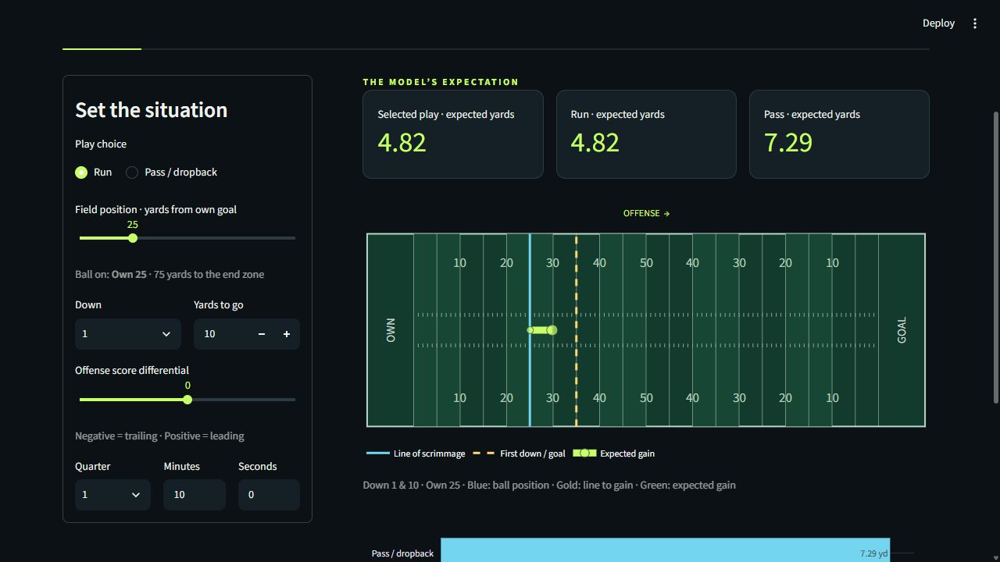

# ML × YARDS

An interactive NFL expected-yards explorer for DAT158 assignment 2, by **Thomas Årland**.
Choose a pre-snap game situation, compare runs with pass/dropback plays, and inspect the
real model evaluation. Python, nflreadpy, scikit-learn, Streamlit and Plotly.

**[Open the live application](https://mlxyards.streamlit.app)**



## Run the website

Use **Python 3.12**. From the repository root:

```bash
python -m venv .venv
```

Activate with `.venv\Scripts\Activate.ps1` on Windows PowerShell or
`source .venv/bin/activate` on macOS/Linux, then:

```bash
python -m pip install -r requirements.txt
python -m streamlit run app.py
```

Open the local URL printed by Streamlit, normally <http://localhost:8501>.
The trained model and evaluation files are included in `artifacts/`: opening the
website does **not** download NFL data or train a model. No API keys are required.
Only load trusted `joblib` files. The lock file pins the training/inference environment.

## What it does

- Automatic predictions when play choice, down, distance, field position, score or clock changes.
- Run and pass/dropback expectations and their difference.
- A field with yard lines, line of scrimmage, first-down/goal marker and expected gain.
- Goal-line distance validation and a quarter clock capped at 15:00.
- Real validation comparisons, 2025 test metrics, distributions, residuals and permutation importance.
- Methodology, limitations, source links and a downloadable evaluation summary.

Pass includes sacks and quarterback scrambles. Run excludes kneels. Historical play
selection is not random: these predictions are **not causal play-calling recommendations**.
The product estimates mean yardage, not the most likely outcome or expected points.

## Reproduce training

```bash
python train.py --cache-dir data/snapshot
python -m pytest -q
```

The included compact source-column snapshots reproduce the supplied experiment without
a download. To independently fetch the source data, run `python train.py` instead.
The first download run loads five nflverse seasons; allow several hundred MB of
network traffic and roughly 2–4 GB free RAM. It caches the study's selected source columns
under ignored `data/raw/`. Subsequent runs reuse those caches. To download again without
deleting anything, use `python train.py --cache-dir data/raw-refresh`.

Training fits preprocessing only on 2021–2023, selects by 2024 validation RMSE, and
evaluates only the selected model on 2025. The selected pipeline is **not refitted** on
validation data, making validation and test results comparable for the deployed fit.
The seed is 42. `metrics.json` records package versions, season counts, source URLs,
cleaning counts and SHA-256 hashes of the local source-column snapshots. nflverse can
revise past data, so fresh downloads may change results; retain the caches to preserve
the exact inputs. The committed `data/snapshot/` files preserve this run's inputs.
No test results were used to tune these candidate models.

| Candidate | 2024 MAE | 2024 RMSE | 2024 R² |
|---|---:|---:|---:|
| Mean baseline | 5.768 | 8.594 | -0.0001 |
| Ridge | 5.613 | 8.481 | 0.0260 |
| Gradient boosting, 15 leaves | **5.578** | **8.441** | **0.0351** |
| Gradient boosting, 31 leaves | 5.586 | 8.452 | 0.0327 |

Selected model, **2025 final test**: MAE **5.518 yd**, RMSE **8.279 yd**, R² **0.0329**.
Splits: 105,580 training plays; 34,728 validation plays; 34,273 test plays.
These are measured results from the included artifacts, not illustrative numbers.
The low R² indicates that these inputs explain only a small part of individual-play variation.

## Repository guide

| Path | Purpose |
|---|---|
| `app.py` | Streamlit website and UI validation |
| `nfl_yards/data.py` | Data access, filtering, features and temporal splits |
| `nfl_yards/model.py` | Candidates, metrics, serialization and inference |
| `nfl_yards/visuals.py` | Field and analysis plots |
| `train.py` | Reproducible training/evaluation entry point |
| `artifacts/` | Trained model and actual evaluation outputs |
| `tests/` | Data, inference and Streamlit interaction tests |
| `data/snapshot/` | Exact source-column snapshots used for reproducibility |
| `docs/sources.md` | References and attribution |

## Deployment

The repository is public at [ThomasAarland/MLxYARDS](https://github.com/ThomasAarland/MLxYARDS).
The website is deployed on Streamlit Community Cloud: [ML × YARDS](https://mlxyards.streamlit.app).

To reproduce the deployment on [Streamlit Community Cloud](https://docs.streamlit.io/deploy/streamlit-community-cloud/deploy-your-app):

1. Sign in with your GitHub account and create an app from this repository.
2. Select the branch containing this project and entry point `app.py`.
3. Choose Python 3.12 in advanced settings and deploy.
4. Verify predictions and the analysis tab after deployment.

The app reads the committed artifacts; the cloud host does not need to train or download
the full dataset.


## Attribution

Data: [nflverse](https://github.com/nflverse/nflverse-data), accessed through
[nflreadpy](https://nflreadpy.nflverse.com/). This project is not affiliated with the NFL.
See [sources](docs/sources.md) for data licensing and tool references.
OpenAI Codex assisted with design, implementation, training execution, tests and report drafting.
Thomas Årland must review the work and be able to explain the submitted model and code.
